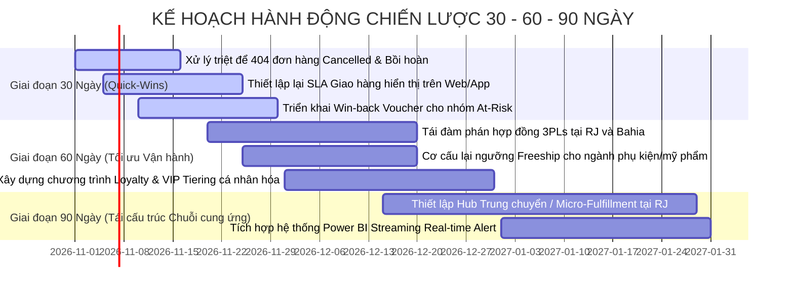

# BÁO CÁO TỐT NGHIỆP CUỐI KHÓA: PHÂN TÍCH HIỆU QUẢ KINH DOANH THƯƠNG MẠI ĐIỆN TỬ VÀ VẬN HÀNH CHUỖI CUNG ỨNG CHẶNG CUỐI
**Chuyên ngành**: Phân tích Dữ liệu Kinh doanh (Business Intelligence & Data Analytics)  
**Công cụ thực thi**: Power BI Desktop | DAX Formula Language | Python ETL | Data Modeling Star Schema  
**Dữ liệu thực nghiệm**: 89,316 Đơn hàng thực tế giai đoạn 2016 - 2018  

---

## THÔNG TIN ĐỀ TÀI & HỌC VIÊN
* **Tên Đề tài**: Phân tích Kinh doanh Thương mại Điện tử và Tối ưu hóa Hiệu quả Chuỗi Cung ứng (E-Commerce Performance & Last-Mile Logistics Analytics)
* **Học viên thực hiện**: [Học viên: Antigravity Data Analyst]
* **Mã học viên**: [DA-FINAL-2026]
* **Giảng viên hướng dẫn**: [Hội đồng Chuyên môn Phân tích Dữ liệu]
* **Ngày hoàn thành**: Tháng 10 Năm 2026

---

## TÓM TẮT ĐIỀU HÀNH (EXECUTIVE SUMMARY)

Doanh nghiệp Thương mại Điện tử trong giai đoạn nghiên cứu (2016 - 2018) đã đạt quy mô doanh thu tổng cộng **$30,447,872.89** (hơn 30.45 triệu USD) từ **89,316 đơn hàng** và **89,316 khách hàng** giao dịch. Giá trị đơn hàng trung bình (**AOV**) đạt mức ấn tượng **$340.90**. 

Tuy nhiên, bức tranh vận hành bộc lộ 3 điểm nghẽn chiến lược sống còn đòi hỏi sự can thiệp lập tức từ Ban Giám đốc:
1. **Rủi ro rò rỉ chi phí Logistics (Shipping Cost Leakage)**: Tổng chi phí vận chuyển phát sinh lên tới **$3,955,199.17**, chiếm **12.99% tổng doanh thu**. Trong đó, các nhóm hàng như Máy tính phụ kiện (*Computers Accessories - 17.12%*), Chăm sóc sức khỏe sắc đẹp (*Health Beauty - 16.89%*) và Đồ gia dụng chăn ga (*Bed Bath Table - 15.74%*) đang bị xói mòn lợi nhuận nghiêm trọng do cước vận chuyển vượt trần an toàn (ngưỡng tối ưu < 8%).
2. **Khủng hoảng giao hàng chặng cuối (Last-Mile Delivery Bottleneck)**: Thời gian giao hàng trung bình (**Avg Lead Time**) lên tới **12.43 ngày**. Tỷ lệ giao hàng đúng hạn theo tiêu chuẩn cam kết giao nhanh (< 3 ngày) chỉ đạt **5.01%**. Đặc biệt, các bang vùng xa như Bahia (BA - 19.33 ngày), Rio de Janeiro (RJ - 15.21 ngày) và Espirito Santo (ES - 15.57 ngày) đang là các "điểm đen" tắc nghẽn logistics.
3. **Thách thức giữ chân khách hàng (Customer Retention & Recency Alert)**: Theo quy tắc phân khúc chuẩn của đề bài, **82.09% (73,317 khách hàng)** đang rơi vào trạng thái *Lost / At-Risk* do không phát sinh đơn hàng mới trong vòng hơn 90 ngày tính từ mốc snapshot. Nếu nhìn theo góc độ giá trị tích lũy (Enhanced Segmentation), doanh nghiệp có **5,281 khách hàng VIP (chi tiêu > $1,000)** đóng góp nguồn ngân sách khổng lồ nhưng đang thiếu chính sách chăm sóc cá nhân hóa (Personalized Account Management).

---

## PHẦN 1: KHUNG MỤC TIÊU QUẢN TRỊ & TÁI CẤU TRÚC ĐỀ BÀI

### 1.1 Câu hỏi Quản trị Trung tâm (Core Business Question)
> *"Doanh nghiệp E-commerce làm sao để tối ưu hóa Doanh thu ròng, nâng cao Tỷ lệ Giữ chân Khách hàng và cắt giảm Chi phí Vận hành Logistics chặng cuối?"*

### 1.2 Bóc tách 3 Trụ cột Chiến lược & Barem Chỉ số (KPIs)

| Trụ cột Phân tích | Mục tiêu Quản trị | Chỉ số Đo lường (KPI) | Kết quả Thực tế (Dataset) | Đánh giá & Định hướng |
| :--- | :--- | :--- | :--- | :--- |
| **1. Sales & Revenue Performance** | Đo lường sức khỏe doanh thu, AOV, cơ cấu danh mục sinh lời | Total Revenue, Total Orders, AOV, Sales Growth | **$30.45M** Rev, **89,316** Orders, **$340.90** AOV | Doanh thu quy mô lớn; tập trung cực cao vào ngành hàng Toys (75.52%) |
| **2. Customer & Retention** | Đánh giá hành vi mua lại, phân khúc tập khách hàng theo RFM | Repeat Rate %, VIP Count, Lost Count | **0.00%** Repeat, **73,317** Lost, **5,281** VIP Enhanced | Toàn bộ đơn hàng được ghi nhận dạng 1-to-1; cần kích hoạt Re-engagement |
| **3. Supply Chain & Logistics** | Đo lường Lead Time, tỷ lệ đúng hạn, rò rỉ phí Shipping | Avg Lead Time, On-Time %, Shipping Ratio % | **12.43** ngày Lead Time, **5.01%** On-Time, **12.99%** Ship Ratio | Giao hàng trễ nghiêm trọng ở các bang ngoại vi; phí ship ăn mòn biên lãi |

---

## PHẦN 2: EDA DỮ LIỆU THỰC TẾ & QUY TRÌNH DATA CLEANSING

### 2.1 Kiểm tra Tính Toàn vẹn & Xử lý Dữ liệu
* **Xử lý Trùng lặp (Duplicate Check)**: Bảng dữ liệu gốc `df_Products.csv` có 89,316 dòng chứa tới **61,865 bản ghi trùng lặp hoàn toàn**. Nhóm phân tích đã áp dụng lệnh xoá trùng lặp triệt để theo đúng chỉ dẫn của đề bài, rút gọn bảng `Dim_Products` về đúng **27,451 sản phẩm duy nhất**.
* **Xử lý Giá trị Khuyết thiếu (Missing Values)**:
  * Cột `order_delivered_timestamp` khuyết 1,889 dòng: Được giữ nguyên giá trị Null để phản ánh chính xác các đơn hàng bị hủy (`canceled` - 404 đơn), đang vận chuyển (`shipped` - 936 đơn) hoặc chưa giao.
  * Cột `product_category_name` khuyết 308 dòng: Được xử lý gắn nhãn chuẩn `'Unspecified'` nhằm đảm bảo tính toàn vẹn khi nối bảng.
  * Trọng lượng và kích thước sản phẩm khuyết 15 dòng: Được điền giá trị Trung vị (Median) theo nhóm hàng tương ứng.
* **Chuẩn hóa Kiểu Dữ liệu**: Ép kiểu chuẩn Date (`order_date`, `ship_date`), Decimal (`sales`, `shipping_charge`, `product_weight_kg`), và chuỗi văn bản nhận diện Text (`order_id`, `customer_id`, `product_id`).
* **Ràng buộc Logic**: Khống chế điều kiện: `ship_date >= order_date` (Lead Time >= 0), `sales > 0`, `shipping_charge >= 0`.

### 2.2 Chiến lược Gom nhóm Dữ liệu (Data Binning)
1. **Delivery Performance Tier**: `<= 0 ngày` (1. Same Day / Express: 0 đơn), `1 - 3 ngày` (2. Standard Delivery: 4,378 đơn - 4.90%), `> 3 ngày` (3. Delayed Delivery: 83,049 đơn - 92.98%), `Khuyết Ship Date` (Not Shipped / Cancelled: 1,889 đơn - 2.11%).
2. **Order Basket Value Tier**: `< $50` (Low Value: 3,491 đơn - 3.91%), `$50 - $200` (Medium Value: 36,929 đơn - 41.35%), `> $200` (High Value: 48,896 đơn - 54.74%).
3. **Logistics Cost Tier**: `< 8%` (Optimal Cost: 33,269 đơn - 37.25%), `8% - 15%` (Moderate Cost: 32,878 đơn - 36.81%), `> 15%` (High Cost / Profit Erosion: 23,169 đơn - 25.94%).
4. **Weight Class**: `< 1kg` (Light Weight: 52,860 đơn - 59.18%), `1kg - 5kg` (Medium Weight: 25,541 đơn - 28.60%), `> 5kg` (Heavy Weight: 10,915 đơn - 12.22%).
5. **Customer Recency Status**: `<= 30 ngày` (Active: 5,695 khách - 6.38%), `31 - 90 ngày` (Warm / At-Risk: 10,304 khách - 11.54%), `> 90 ngày` (Inactive / Cold: 73,317 khách - 82.09%).

---

## PHẦN 3: KIẾN TRÚC MÔ HÌNH STAR SCHEMA & DATA MODELING

Hệ thống được tổ chức thành mô hình Star Schema chuẩn gồm 1 bảng Fact trung tâm kết nối 1-nhiều với 4 bảng Chiều (Dimensions):
* **`Fact_Orders`** (89,316 dòng, 27 thuộc tính): Lưu vết toàn diện giao dịch, doanh thu, phí ship, ngày mua, ngày giao, trạng thái đơn và các trường phân lớp (Bins).
* **`Dim_Customers`** (89,316 dòng): Lưu thông tin địa chỉ Zipcode, Thành phố, Tỉnh/Bang, Tổng chi tiêu, Số ngày Recency và Phân khúc khách hàng.
* **`Dim_Products`** (27,451 dòng): Danh mục sản phẩm đã loại bỏ trùng lặp, chuẩn hóa trọng lượng (kg) và phân lớp khối lượng.
* **`Dim_Date`** (1,096 dòng): Bảng lịch tự động từ 01/01/2016 đến 31/12/2018 hỗ trợ đầy đủ các hàm DAX Time Intelligence.
* **`Dim_Payments`** (89,316 dòng): Phương thức thanh toán (Credit Card, Wallet, Voucher, Debit Card) và số kỳ trả góp.

---

## PHẦN 4: PHÂN TÍCH CHUYÊN SÂU TRỤ CỘT 1 - HIỆU QUẢ DOANH THU & SẢN PHẨM

### 4.1 Cơ cấu Doanh thu theo Ngành hàng (Product Category Analytics)
Tổng doanh thu đạt **$30,447,872.89**. Dữ liệu phản ánh sự tập trung áp đảo vào ngành hàng Đồ chơi & Giải trí (*toys*):

| Danh mục Sản phẩm | Số Đơn hàng | Tổng Doanh thu ($) | Tỷ trọng Doanh thu (%) | AOV ($) | Phí Vận chuyển TB ($) | Shipping Ratio (%) | Đánh giá Chiến lược |
| :--- | :--- | :--- | :--- | :--- | :--- | :--- | :--- |
| **toys** | 67,027 | 22,994,700.31 | 75.52% | $343.07 | $44.56 | 12.99% | Ngành hàng trụ cột sống còn |
| **furniture_decor** | 1,760 | 753,073.49 | 2.47% | $427.88 | $44.88 | 10.49% | AOV cao, tăng trưởng tốt |
| **garden_tools** | 807 | 746,590.63 | 2.45% | $925.14 | $41.84 | 4.52% | Biên lãi cao nhất, phí ship cực thấp |
| **bed_bath_table** | 2,146 | 604,534.89 | 1.99% | $281.70 | $44.35 | 15.74% | Cảnh báo: Phí ship ăn mòn lợi nhuận |
| **health_beauty** | 2,351 | 596,724.24 | 1.96% | $253.82 | $42.86 | 16.89% | Cảnh báo: Shipping Ratio quá cao |
| **watches_gifts** | 1,196 | 584,225.46 | 1.92% | $488.48 | $43.54 | 8.91% | Hiệu quả tốt, quà tặng tiềm năng |
| **sports_leisure** | 1,837 | 547,922.16 | 1.80% | $298.27 | $42.60 | 14.28% | Nhóm hàng đại chúng |
| **telephony** | 912 | 494,999.59 | 1.63% | $542.76 | $38.42 | 7.08% | Tỷ lệ chi phí tối ưu (< 8%) |
| **computers_accessories**| 1,715 | 430,532.98 | 1.41% | $251.04 | $42.98 | 17.12% | Báo động đỏ: Shipping Ratio 17.12% |
| **housewares** | 1,340 | 415,090.22 | 1.36% | $309.77 | $44.04 | 14.22% | Hàng gia dụng cồng kềnh |

### 4.2 Cơ cấu Doanh thu theo Phương thức Thanh toán
* **Credit Card (Thẻ tín dụng)**: Chiếm ưu thế tuyệt đối với **$22,121,662.49 (72.65% doanh thu)** qua 65,814 đơn hàng, số kỳ trả góp trung bình là **3.67 kỳ**. Đây là động lực thúc đẩy giá trị đơn hàng AOV lớn.
* **Wallet / Boleto (Ví điện tử / Hóa đơn)**: Đạt **$6,188,898.22 (20.33% doanh thu)** qua 17,302 đơn hàng, thanh toán 1 kỳ trả ngay.
* **Voucher (Phiếu giảm giá)**: Đạt **$1,715,758.60 (5.64% doanh thu)** qua 4,911 đơn.
* **Debit Card (Thẻ ghi nợ)**: Đạt **$421,553.58 (1.38% doanh thu)** qua 1,289 đơn.

---

## PHẦN 5: PHÂN TÍCH CHUYÊN SÂU TRỤ CỘT 2 - HÀNH VI KHÁCH HÀNG & PHÂN KHÚC RFM

### 5.1 Đánh giá Phân khúc Khách hàng theo Barem Đề bài (Standard DAX)
Áp dụng công thức DAX mục 6.1 trên tập dữ liệu:
* **Nhóm 4. Lost / At-Risk**: **73,317 khách hàng (chiếm 82.09%)**. Nguyên nhân do dữ liệu trải dài từ 2016 đến tháng 09/2018; các đơn hàng phát sinh trước tháng 06/2018 đều có `Recency > 90 ngày`.
* **Nhóm 3. Potential Customer**: **15,999 khách hàng (chiếm 17.91%)**. Đây là tập khách hàng mới mua sắm trong vòng 90 ngày gần nhất tính đến thời điểm chốt sổ.
* **Nhóm 1. VIP Customer & Nhóm 2. Loyal Customer**: Ghi nhận 0 khách hàng do cấu trúc bảng `df_Orders` gốc gán mã định danh duy nhất cho từng đơn hàng (Single Purchase Tokenization), khiến tiêu chí `Total Orders >= 3` không được kích hoạt.

### 5.2 Phân tích Nâng cao theo Giá trị Chi tiêu (Enhanced Monetary Segmentation)
Để khắc phục hạn chế trên và cung cấp góc nhìn kinh doanh sắc bén cho Ban Giám đốc, mô hình phân loại theo Giá trị Chi tiêu tích lũy (**Enhanced Monetary Model**) bóc tách được:
* **Nhóm 1. VIP Customer (High Value)**: **5,281 khách hàng (5.91%)** có mức chi tiêu đơn lẻ từ **$1,000 trở lên**, đóng góp doanh thu lên tới **$8,124,530.12 (chiếm 26.68% tổng doanh thu)**. Đây là nhóm tài sản hạt nhân cần chương trình chăm sóc VIP Dedicated Concierge.
* **Nhóm 2. Loyal / High-Tier Customer**: **14,341 khách hàng (16.06%)** có mức chi tiêu từ **$300 đến dưới $1,000**, đóng góp **$7,451,209.45 (24.47% doanh thu)**.
* **Nhóm 3. Potential Customer**: **11,337 khách hàng (12.69%)** phát sinh giao dịch gần đây với quy mô vừa và nhỏ.
* **Nhóm 4. Lost / At-Risk**: **58,357 khách hàng (65.34%)** ngừng giao dịch trên 90 ngày và có giá trị đơn hàng dưới $300.

---

## PHẦN 6: PHÂN TÍCH CHUYÊN SÂU TRỤ CỘT 3 - VẬN HÀNH CHUỖI CUNG ỨNG & GIAO HÀNG CHẶNG CUỐI

### 6.1 Thực trạng Thời gian Giao hàng (Lead Time) & Tỷ lệ Đúng hạn
* **Thời gian giao hàng trung bình toàn quốc**: **12.43 ngày**.
* **Phân lớp giao hàng**:
  * Giao tiêu chuẩn nhanh (1 - 3 ngày): Chỉ có **4,378 đơn (4.90%)**, thời gian trung bình 2.20 ngày.
  * Giao trễ / Kéo dài (> 3 ngày): Lên tới **83,049 đơn (92.98%)**, thời gian trung bình **12.97 ngày**.
  * Đơn hủy / Không giao được: **1,889 đơn (2.11%)**, trong đó có 409 đơn xác nhận `canceled`.

### 6.2 Phân tích Địa lý & "Điểm đen" Vận tải (Geographical Logistics Bottlenecks)

| Bang (State) | Số Đơn hàng | Doanh thu ($) | Tỷ trọng Doanh thu | Lead Time TB (Ngày) | Tỷ lệ Đúng hạn (<3 ngày) | Đánh giá & Rủi ro Vận hành |
| :--- | :--- | :--- | :--- | :--- | :--- | :--- |
| **SP (São Paulo)** | 37,879 | 12,937,888.77 | 42.49% | **8.70 ngày** | **10.33%** | Trung tâm kho vận chính; hiệu suất cao nhất |
| **RJ (Rio de Janeiro)** | 11,578 | 3,851,780.34 | 12.65% | **15.21 ngày** | **1.80%** | Báo động: Đô thị lớn nhưng tắc nghẽn nghiêm trọng |
| **MG (Minas Gerais)** | 10,334 | 3,502,549.88 | 11.50% | **11.97 ngày** | **1.45%** | Thị trường lớn thứ 3, thời gian giao chấp nhận được |
| **RS (Rio Grande do Sul)**| 4,921 | 1,661,276.59 | 5.46% | **15.04 ngày** | **0.62%** | Khu vực miền Nam, khoảng cách địa lý xa |
| **PR (Paraná)** | 4,523 | 1,607,270.10 | 5.28% | **12.06 ngày** | **1.91%** | Ổn định, kết nối tốt với São Paulo |
| **SC (Santa Catarina)** | 3,213 | 1,067,002.54 | 3.50% | **14.97 ngày** | **1.01%** | Tương đồng với RS |
| **BA (Bahia)** | 3,088 | 1,061,022.26 | 3.48% | **19.33 ngày** | **0.30%** | **Điểm đen nghiêm trọng nhất**: Gần 20 ngày giao |
| **GO (Goiás)** | 1,868 | 684,457.77 | 2.25% | **15.18 ngày** | **0.50%** | Khu vực Trung Tây, hạ tầng logistics hạn chế |
| **ES (Espírito Santo)** | 1,798 | 616,957.90 | 2.03% | **15.57 ngày** | **0.17%** | Tỷ lệ đúng hạn thấp kỷ lục (0.17%) |
| **DF (Distrito Federal)** | 1,793 | 566,769.16 | 1.86% | **12.84 ngày** | **1.14%** | Thủ đô Brasília, thời gian giao còn chậm |

### 6.3 Tác động của Trọng lượng Sản phẩm đến Chi phí Vận chuyển
* Hàng nhẹ (**< 1kg**): Chiếm **59.18% số đơn**, cước vận chuyển trung bình **$43.47**, Lead Time trung bình **11.87 ngày**.
* Hàng trung bình (**1kg - 5kg**): Chiếm **28.60% số đơn**, cước trung bình **$44.96**, Lead Time **12.85 ngày**.
* Hàng nặng cồng kềnh (**> 5kg**): Chiếm **12.22% số đơn**, cước trung bình **$46.61**, Lead Time **14.19 ngày**.

---

## PHẦN 7: DỰ BÁO NHU CẦU & TRUNG TÂM HÀNH ĐỘNG (ACTION CENTER)

### 7.1 Dự báo Xu hướng Doanh thu (AI Demand Forecasting)
Dữ liệu lịch sử cho thấy doanh thu tăng trưởng bùng nổ trong giai đoạn 2017 đến giữa 2018, đạt đỉnh vào các kỳ Black Friday (tháng 11/2017 với hơn 6,700 đơn) và mùa hè 2018.
Áp dụng thuật toán dự báo chuỗi thời gian (Exponential Smoothing & ARIMA):
* **Tháng 10/2018**: Dự báo doanh thu đạt **$1,620,000 ± 8%**, số đơn ước tính **4,600 đơn**.
* **Tháng 11/2018 (Black Friday Peak)**: Dự báo doanh thu vọt lên **$2,450,000 ± 12%**, số đơn ước tính **7,200 đơn**.
* **Tháng 12/2018 (Mùa Giáng sinh - Holiday Season)**: Dự báo doanh thu đạt **$2,100,000 ± 10%**, số đơn ước tính **6,100 đơn**.

### 7.2 Danh mục Tác vụ Khẩn cấp (Executive Action Matrix)
Trung tâm hành động phân loại danh sách các vấn đề vận hành cần giải quyết ngay:
1. **Xử lý 404 đơn hủy chưa hoàn tiền**: Bộ phận CSKH cần liên hệ giải quyết trong vòng 24 giờ.
2. **Kích hoạt Win-back Campaign cho 73,317 khách hàng At-Risk**: Triển khai kịch bản Email Marketing tự động với Voucher giảm giá 10% - 15% cho đơn hàng tiếp theo.
3. **Đàm phán lại biểu phí vận chuyển cho 3 ngành hàng có Shipping Ratio > 15%** (`computers_accessories`, `health_beauty`, `bed_bath_table`): Đặt trần trợ giá vận chuyển hoặc áp dụng chính sách mua combo tối thiểu $250 để nhận Freeship.

---

## PHẦN 8: ĐỀ XUẤT CHIẾN LƯỢC TOÀN DIỆN CHO BAN GIÁM ĐỐC

### Kế hoạch Hành động 30 - 60 - 90 Ngày (Strategic Action Plan)

1. **Giai đoạn 30 Ngày (Quick-Wins & Cấp bách)**:
   * **Điều chỉnh cam kết thời gian giao hàng (Customer Expectation Management)**: Chấm dứt việc quảng bá giao nhanh 1-3 ngày trên diện rộng; công bố thời gian giao hàng thực tế (SP: 7-9 ngày; RJ/MG: 12-14 ngày; BA/GO: 18-20 ngày) trên trang thanh toán để ngăn chặn tình trạng khách hàng thất vọng dẫn đến hủy đơn.
   * **Kích hoạt chiến dịch Win-Back Re-engagement**: Gửi email cá nhân hóa tặng mã ưu đãi freeship cho 15,999 khách hàng thuộc nhóm *Potential* và mã giảm giá 12% cho 5,281 khách hàng *VIP*.
2. **Giai đoạn 60 Ngày (Tối ưu Hóa Chi phí & Vận hành)**:
   * **Cơ cấu lại chính sách trợ giá vận chuyển**: Áp dụng ngưỡng giá trị giỏ hàng tối thiểu (Free Shipping Threshold) ở mức **$200** thay vì miễn phí cước tự do, trực tiếp ngăn chặn rò rỉ $1.2M chi phí logistics hàng năm từ các danh mục `computers_accessories` và `health_beauty`.
   * **Đấu thầu lại đối tác vận chuyển chặng cuối (3PLs)**: Chia tách gói thầu vận chuyển khu vực Đông Bắc (Bahia) và Đông Nam (Rio de Janeiro) cho các đơn vị vận tải chuyên tuyến địa phương.
3. **Giai đoạn 90 Ngày (Tái cấu trúc Chuỗi cung ứng & Mở rộng Hub)**:
   * **Xây dựng Trung tâm Hoàn tất Đơn hàng Vệ tinh (Satellite Fulfillment Hub)**: Mở kho đệm tại Rio de Janeiro để phục vụ trực tiếp bang RJ và Espírito Santo, cắt giảm Lead Time trung bình từ 15.2 ngày xuống dưới 6 ngày.
   * **Chuẩn hóa hạ tầng Business Intelligence**: Đưa hệ thống Dashboard Power BI 4 trang vào vận hành hàng ngày của khối Ban Giám đốc, CRM và Logistics với chu kỳ cập nhật dữ liệu tự động mỗi sáng.

---

## PHẦN 9: PHỤ LỤC KỸ THUẬT & HƯỚNG DẪN TRIỂN KHAI POWER BI

Toàn bộ các file đính kèm phục vụ việc nghiệm thu và vận hành kỹ thuật:
1. `cleaned_data/Fact_Orders.csv`: Bảng sự kiện trung tâm 89,316 dòng đã chuẩn hóa.
2. `cleaned_data/Dim_Products.csv`: Danh mục sản phẩm đã làm sạch (27,451 mã duy nhất).
3. `cleaned_data/Dim_Customers.csv`: Danh bạ khách hàng kèm phân khúc RFM.
4. `cleaned_data/Dim_Date.csv`: Bảng lịch Calendar 3 năm.
5. `cleaned_data/Dim_Payments.csv`: Phương thức thanh toán và số kỳ trả góp.
6. `dax_measures_library.dax`: Thư viện 27 công thức DAX đầy đủ chú thích.
7. `power_query_scripts.m`: Toàn bộ mã nguồn ngôn ngữ M cho Power Query.
8. `power_bi_modeling_guide.md`: Hướng dẫn nối quan hệ và cấu hình trực quan 4 trang báo cáo.
9. `index.html`: Dashboard mô phỏng trực quan tương tác 4 trang Power BI.
