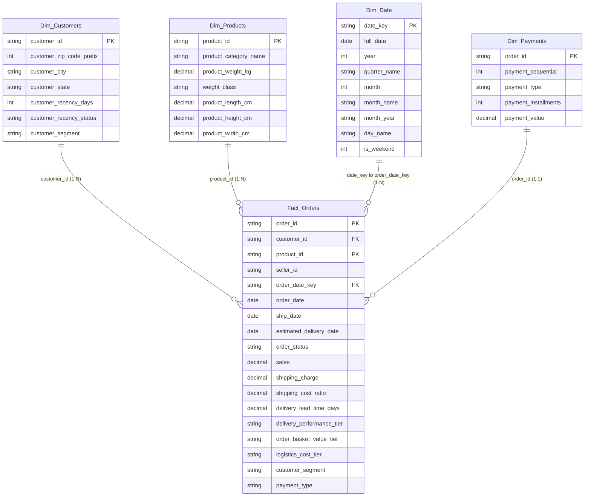

# HƯỚNG DẪN TRIỂN KHAI MÔ HÌNH HÓA DỮ LIỆU & THIẾT KẾ POWER BI REPORT
**Đề tài**: Phân tích Kinh doanh Thương mại Điện tử và Hiệu quả Chuỗi cung ứng  
**Khóa luận / Báo cáo Tốt nghiệp Data Analytics**

---

## 1. Kiến trúc Mô hình Dữ liệu Star Schema (Data Model)

Mô hình dữ liệu được thiết kế theo chuẩn **Star Schema** tối ưu cho Power BI với bảng sự kiện trung tâm `Fact_Orders` và 4 bảng chiều (Dimensions):

### Bảng Thiết lập Quan hệ trong Power BI Model View

| Bảng Từ (From Table) | Khóa (Key) | Bảng Đến (To Table) | Khóa (Key) | Cardinality | Cross Filter Direction | Ghi chú |
| :--- | :--- | :--- | :--- | :--- | :--- | :--- |
| **Dim_Customers** | `customer_id` | **Fact_Orders** | `customer_id` | One to Many (1:*) | Single | Lọc theo khách hàng, vùng miền |
| **Dim_Products** | `product_id` | **Fact_Orders** | `product_id` | One to Many (1:*) | Single | Lọc theo danh mục, trọng lượng |
| **Dim_Date** | `date_key` | **Fact_Orders** | `order_date_key` | One to Many (1:*) | Single | Chuẩn Time Intelligence |
| **Dim_Payments** | `order_id` | **Fact_Orders** | `order_id` | One to One (1:1) | Both hoặc Single | Phân tích phương thức trả tiền |

---

## 2. Quy chuẩn Thiết kế UI/UX theo Tài liệu Hướng dẫn (Phần 5)

### Bảng màu Hệ thống (System Palette)
* **Primary Navy Blue**: `#0A192F` / `#1E3A8A` (Header, Title, Thẻ Card chính).
* **Background Ice Gray**: `#F8FAFC` (Nền trang tổng thể, tạo độ tương phản cao, dịu mắt).
* **Positive Highlight**: `#10B981` (Tăng trưởng dương, Giao đúng hạn, VIP).
* **Alert Highlight**: `#EF4444` (Đơn trễ, Đơn hủy, Khách hàng Lost, Chi phí Shipping vượt ngưỡng).
* **Secondary Accents**: `#2563EB` (Ocean Blue) & `#F59E0B` (Amber Warm) cho các chuỗi dữ liệu đa nhánh.

---

## 3. Cấu trúc & Visual Chi tiết 4 Trang Báo cáo

### Trang 1: Executive Sales & Revenue Overview (Tổng quan Doanh thu)
1. **Banner Top Cards**:
   * Card 1: `Total Revenue` ($30.45M)
   * Card 2: `Total Orders` (89,316)
   * Card 3: `Average Order Value` ($340.90)
   * Card 4: `Sales Growth MoM %`
2. **Line & Clustered Column Chart**: Trục X = `Dim_Date[month_year]`, Column = `Total Revenue`, Line = `Average Order Value`.
3. **Donut Chart**: Legend = `Dim_Products[product_category_name]`, Values = `Total Revenue` (Lọc Top 7 danh mục lớn nhất).
4. **Horizontal Bar Chart**: Y-Axis = `Dim_Products[product_category_name]` hoặc Top 10 Product IDs, X-Axis = `Total Revenue`.
5. **Matrix Table**: Rows = `Fact_Orders[customer_state]`, Columns = `Fact_Orders[payment_type]`, Values = `Total Revenue` & `Average Order Value`.

### Trang 2: Customer Behavior & Loyalty Segmentation (Hành vi & Khách hàng)
1. **Top Cards**:
   * Card 1: `Total Customers` (89,316)
   * Card 2: `Repeat Purchase Rate %`
   * Card 3: `VIP Customer Count` (hoặc VIP Enhanced: 5,281)
   * Card 4: `Lost Customer Count` (73,317)
2. **Donut Chart**: Legend = `Fact_Orders[customer_segment]`, Values = `Total Customers`.
3. **Clustered Bar Chart**: Y-Axis = `Fact_Orders[customer_segment]`, X-Axis = `Average Order Value` hoặc `Revenue Per Customer`.
4. **Scatter Plot**: X-Axis = `Total Orders`, Y-Axis = `Total Spend`, Size = `Average Order Value`, Legend = `Customer Segment`.
5. **Tree Map**: Group = `customer_state`, Details = `customer_segment`, Values = `Total Revenue`.

### Trang 3: Supply Chain & Last-Mile Logistics Operations (Vận hành Chuỗi cung ứng)
1. **Top Cards**:
   * Card 1: `On-Time Delivery Rate %` (5.01% - Đánh giá theo chuẩn 3 ngày)
   * Card 2: `Avg Delivery Lead Time` (12.43 ngày)
   * Card 3: `Cancellation Rate %` (0.46%)
   * Card 4: `Total Shipping Cost` ($3.96M, chiếm 12.99% Doanh thu)
2. **Clustered Bar Chart**: Y-Axis = `Fact_Orders[delivery_performance_tier]`, X-Axis = `Total Orders` & `Total Shipping Cost`.
3. **Heatmap Grid / Matrix with Conditional Formatting**: Rows = `product_category_name`, Columns = `customer_state`, Values = `Avg Delivery Lead Time`.
4. **100% Stacked Bar Chart**: X-Axis = `Fact_Orders[weight_class]`, Values = `Fact_Orders[order_status]`.
5. **Scatter Plot**: X-Axis = `Dim_Products[product_weight_kg]`, Y-Axis = `Fact_Orders[shipping_charge]`.

### Trang 4: Demand Forecasting & Executive Action Center (Dự báo & Hành động)
1. **Line Chart với AI Forecasting**:
   * Trục X = `Dim_Date[month_year]`, Values = `Total Revenue` & `Total Orders`.
   * Bật tab Analytics -> **Forecast** -> Dự báo thêm 3 tháng (3 periods) với độ tin cậy 95%.
2. **Decomposition Tree (AI Cây Phân Rã)**:
   * Analyze: `Total Revenue` (hoặc `Avg Delivery Lead Time`).
   * Explain by: `customer_state`, `product_category_name`, `payment_type`, `delivery_performance_tier`.
3. **Actionable Detail Matrix Table (Bảng Tác vụ Khẩn cấp)**:
   * Cột hiển thị: `Customer ID`, `Customer State`, `Segment`, `Recency Days`, `Order Status`, `Lead Time Days`, `Shipping Cost Ratio %`.
   * Thêm cột Conditional Formatting cảnh báo Coral Red cho các đơn trễ > 15 ngày và tỷ lệ cước vận chuyển > 15%.
